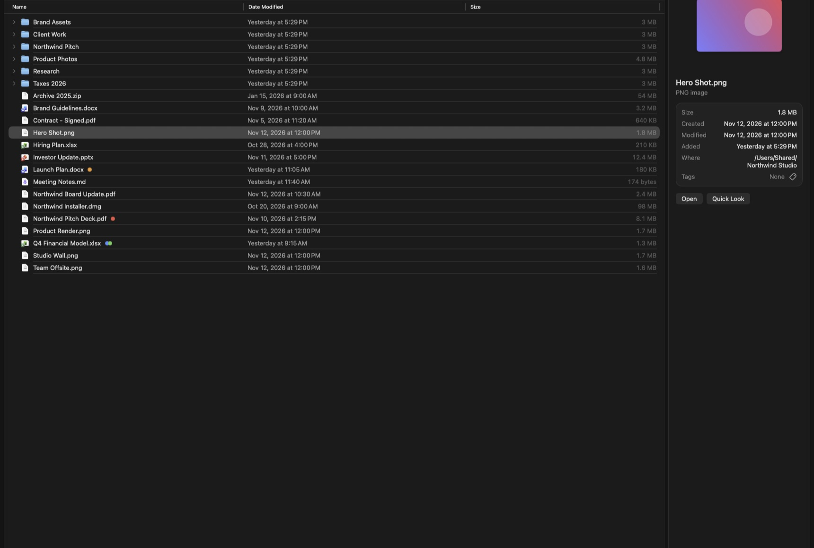
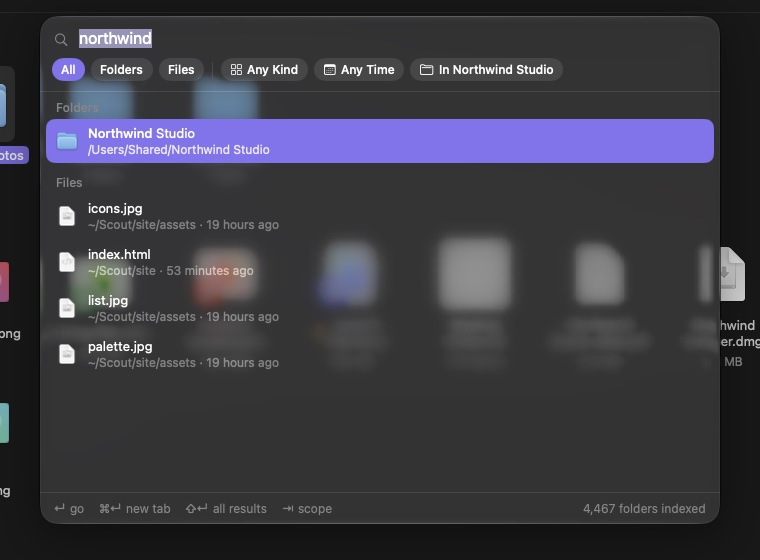
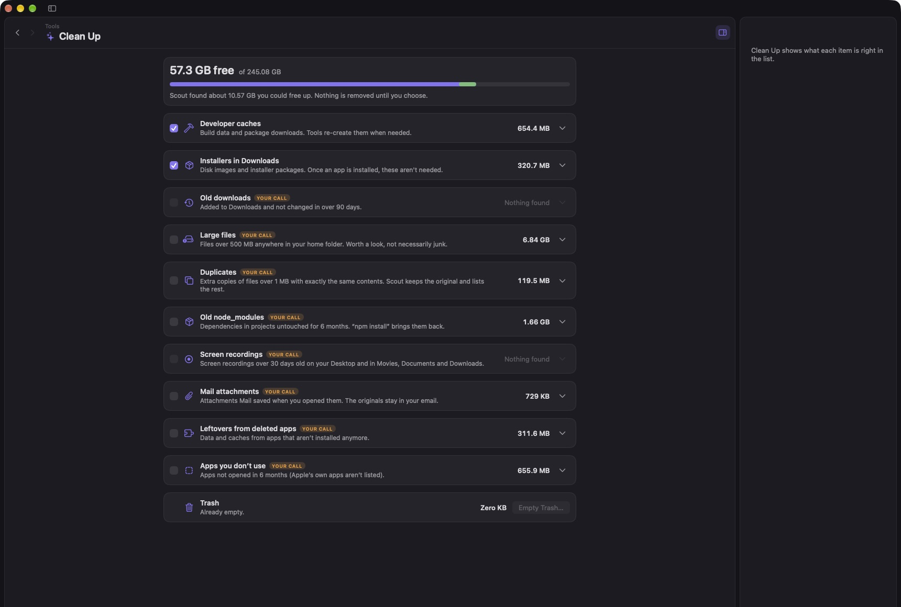

  

<h1 align="center">Scout</h1>

  <b>The fastest way around your Mac.</b> 
  A free file browser for macOS. Press ⌥Space from any app, type a few letters, and you're in the folder.

  <a href="https://github.com/jackpawlik26/scout/releases/latest/download/Scout.zip"><b>⬇︎ Download Scout</b></a>
  &nbsp;·&nbsp; macOS 26 or later &nbsp;·&nbsp; Apple silicon and Intel &nbsp;·&nbsp; Free and open source

  

## Install

1. **[Download Scout.zip](https://github.com/jackpawlik26/scout/releases/latest/download/Scout.zip)** and open it. You'll get **Scout.app** (Safari often unzips it for you).
2. Drag **Scout** into your **Applications** folder.
3. Open Scout. The first time, macOS says it can't verify the app, because Scout isn't registered with Apple's paid developer program. To allow it, once:
   - Click **Done** on that message.
   - Open **System Settings ▸ Privacy & Security** and scroll down to **Security**.
   - Next to "Scout was blocked to protect your Mac", click **Open Anyway**, then confirm with your password or Touch ID.

After that, Scout opens like any other app. macOS will also ask whether Scout can see your Downloads, Desktop and Documents folders: click **Allow** (it's a file browser, so it needs to). To skip those questions, give Scout **Full Disk Access** in System Settings ▸ Privacy & Security. To get a newer version later, download it again and replace the old one in Applications.

**Optional:** in Scout's **Settings** (⌘,), turn on **Open folders in Scout** and **Use Scout for "Show in Finder"** to make Scout your everyday file browser, and **Open at login** to keep ⌥Space ready.

## What it does

**Find anything in a few keystrokes.** Press ⌥Space in any app, or ⌘K inside Scout, and type a few letters. Folders you use most come first; files are found by name or by what's inside them. Filter by kind or date, and save searches you repeat.

**Browse your way.** Tabs, split view (⌘D), list, icons or columns, and folders that open in place. Tabs and splits come back after you quit, just like Finder.

**Move things without dragging.** Select files, press ⇧⌘M, type a few letters of where they should go, and press Return. Every move, rename and trash can be undone with ⌘Z.

**Keep things tidy.** Group a folder by kind or date, sort loose downloads into folders with one shortcut, and gather folders from anywhere onto one page with workspaces.

**Rename hundreds of files in one go.** Select them and press Return: stack steps like replace (with regular expressions), add text, change case or a new name such as `Trip {n}` or `{created:yyyy-MM-dd} {name}`, watch the preview, and save it as a preset for next time.

**See what's taking space.** The info panel shows what fills a folder. Clean Up finds old installers, big downloads, duplicate files and developer caches, and everything goes to the Trash, so nothing is lost by accident.

**Made for the keyboard.** Almost everything has a shortcut, and you can change 50 of them. Press ⌘/ in Scout for the list, or see [all shortcuts](docs/SHORTCUTS.md).

**For developers.** Turn on **Settings ▸ Developer tools** for git branch and file status in every folder, Open in Terminal or your editor, and a page for your Homebrew and npm packages. There are also `scout://` links, a `scout` command and a Raycast extension. See [Scout for power users](docs/POWER-USERS.md).

**Private.** No account, no tracking. Your files and Scout's index stay on your Mac.

## Questions

- **Does Scout replace Finder?** It does nearly everything Finder does and adds a lot, but Finder stays on your Mac: it still runs the Desktop and the Open/Save windows inside other apps. You can switch back any time by turning off Scout's two settings above.
- **Why does macOS warn me the first time?** Apple charges developers $99 a year to sign apps. Scout isn't signed yet, so macOS asks you to approve it once. The full source code is here for anyone to read.
- **Scout can't see some folders.** You may have clicked "Don't Allow" on one of macOS's questions. Give Scout **Full Disk Access** in System Settings ▸ Privacy & Security, the same as other file browsers.
- **Found a bug or have an idea?** [Open an issue](https://github.com/jackpawlik26/scout/issues/new/choose); a short description and a screenshot are plenty.

## More

- [What's new](https://github.com/jackpawlik26/scout/releases): every release and its changes
- [Keyboard shortcuts](docs/SHORTCUTS.md)
- [Scout for power users](docs/POWER-USERS.md): links, Shortcuts app, the `scout` command, Raycast
- [Developing Scout](docs/DEVELOPING.md): build it yourself, how the code is organized, making a release

Scout is open source under the [MIT License](LICENSE).
